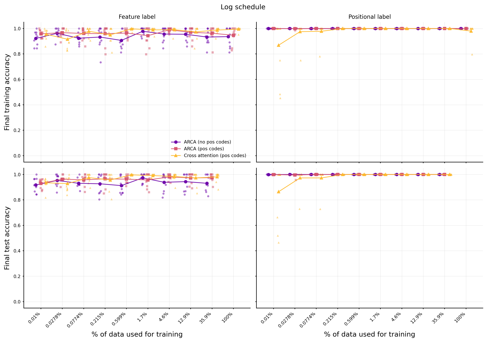

# The adaptive relational bottleneck: regulation of attention in the service of abstraction

This repo contains code and analyses pertaining to a project about understanding when it is appropriate to use the relational bottleneck. Given that the relational bottleneck is an inductive bias, the No Free Lunch Theorem tells us that there are some tasks that using the relational bottleneck will result in worse performance. Therefore, if we allow the relational bottleneck to be adaptive, we might be able to recover performance on those tasks.

> **Project status:** this project is on hold and is not under active development. The code and results are shared as-is. Some findings are still open (see [Sampling-percentage sweep](#sampling-percentage-sweep)).

## Getting started

Dependencies are managed with [uv](https://docs.astral.sh/uv/) (Python ≥ 3.13):

```bash
uv sync
uv run python scripts/context_identification/pos_codes/pos_codes_comparison_sweep.py   # example experiment
uv run python scripts/tests/test_train_test_split.py                                     # tests are standalone scripts
```

Run every script from the repository root. Scripts write raw outputs to `data/`, which is **not distributed** (it is gitignored). Re-run the relevant sweep script to regenerate it. Figures and summary tables are committed under `results/`.

## Repository layout

| Path | Contents |
| --- | --- |
| `src/adaptive_bottleneck/` | ARCA attention (`models.py`), synthetic tasks (`tasks.py`: `XOR`, `BlockComparison`, `ContextIdentification`), and saving and plotting utilities |
| `scripts/context_identification/` | Context identification experiments, grouped by how γ is set: `fixed_gamma/`, `online_gamma/` (γ learned by backprop), `meta_gamma/` (γ meta-optimized through an unrolled inner loop), `lagrange_gamma/` (Lagrangian/regression rule), and `pos_codes/` (ARCA vs. positional-code baselines) |
| `scripts/xor/`, `scripts/block_task/` | Smaller XOR and block-comparison experiments |
| `scripts/tests/` | Standalone sanity-check scripts |
| `slurm/`, `scripts/della/` | Cluster job scripts for the larger sweeps |
| `results/` | Figures and summary CSVs (mirrors the `scripts/` layout) |
| `notebooks/` | Analysis and figure notebooks |
| `docs/` | LaTeX write-ups: attention walkthrough, context identification task, Lagrangian γ optimization, XOR, figures |
| `claude/` | Dated working-session logs (research notebook kept with Claude Code) |

## Architecture

### Previous work

As proposed in Vaswani et al. (2017), the attention mechanism is formalized as

$$\text{Attention}(Q, K, V)=\text{softmax }\left(\frac{QK^\top}{\sqrt{d}}\right) V$$

where matrices $Q,K,V$ correspond to concatenated query, key, and value vectors. To explicitly operate over data, the attention mechanism is extended to the cross-attention mechanism as

$$\text{Cross Attention}(X_q, X_c; W_q, W_k, W_v) = \text{softmax }\left(\frac{(X_qW_q)(X_cW_k)^\top}{\sqrt{d}}\right)(X_cW_v)$$

where some query matrix $X_q$ is compared across a contextual matrix $X_c$ to index similar items in the context as determined by the query and key matrices $W_q,W_k$.

Following from the work in Altabaa et al. (2024), the cross-attention mechanism is extended to explicitly compute relations to relational cross attention (RCA) mechanism to operate over abstract symbols via

$$\text{RCA}(X_q, X_c; W_q, W_k, S)= \text{softmax }\left(\frac{(X_qW_q)(X_cW_k)^\top}{\sqrt{d}}\right)S~.$$

Here, values $V$ are now symbols $S$ that are, unlike in cross attention, restricted from seeing the context $X_c$. This is an instantiation of the relational bottleneck principle (Webb et al., 2024).

### Our contribution

We extend the cross- and relational-attention mechanisms in the spirit of the relational bottleneck principle by formulating the _adaptive relational-cross attention_ (ARCA) mechanism as

$$\text{ARCA}(X_q, X_c; \gamma, W_q, W_k, W_v)= \text{softmax }\left(\frac{(X_qW_q)(X_cW_k)^\top}{\sqrt{d}}\right)\left[(1-\gamma)X_c+\gamma I\right]W_v$$

whereby the value matrix $V$ now becomes
$$
V = \left[(1-\gamma)X_c+\gamma I\right]W_v~,
$$
effectively acting as a linear interpolation between the cross- and relational-cross attention mechanisms. The $\gamma$ term can be a free parameter, allowing for gradient descent to ''open'' or ''close'' the relational bottleneck depending on task demands. When $\gamma=1$, ARCA collapses to RCA where $S=\gamma I W_v$, and when $\gamma=0$, ARCA to cross attention.

## Results

### Context Identification

To demonstrate the computation benefits of ARCA in a simple setting, we designed the _contextual identification task_ whereby a model is presented with a context matrix $X_c$ and a query vector $x_q$ and is tasked to identify which item the context matrix $X_c$, denoted as $x^\ast_c$, is most similar to the query $x_q$. Input data consisted of one-hot vectors, with a distance metric defined as the absolute value of the difference between the one-hot index of two vectors $\mathbf{u}, \mathbf{v}$

$$d(\mathbf{u}, \mathbf{v}) = \left| \arg\max_i  u_i - \arg\max_j  v_j \right|~.$$

Crucially, we manipulated the task such that the model was task to either output the position of $x^\ast_c$ in the context matrix $X_c$, termed the _positional_ label, or the feature identity of $x^\ast_c$, termed the _feature_ label.

Given the positional nature of the  context identification task, we thought to test whether ARCA provided a benefit over injecting positional codes directly into the context matrix $X_c$, much like it Vaswani et al. 2017. We encoded position as a one-hot vector and appended each row in $X_c$ with its corresponding vector identity. In our original, small-sample experiment (500 training examples, $L=10$, 20 seeds), ARCA without positional codes performed better than both ARCA with positional codes and cross attention with positional codes (test accuracy, %):

| Condition                  | Feature         | Position        |
| --------                   | --------        | --------        |
| ARCA (no Pos)              | $98.5\pm 0.4$   | $99.0\pm 0.2$   |
| ARCA (with Pos)            | $79.9\pm 5.2$   | $80.7\pm 5.7$   |
| Cross attention (with Pos) | $78.0\pm 5.1$   | $72.3\pm 7.9$   |

#### Sampling-percentage sweep

To test whether this gap reflects sample efficiency, we enumerated the full task population at $L=8$ (13,969,440 unique examples). We then trained each condition on fractions of it, from 0.01% (≈1,400 examples) to 100%, with two schedules: log-spaced and 10% increments. Each run used mini-batches of 64 for 300,000 steps, with 10 seeds per condition. Up to 20% of the population was held out for testing.

Mean final test accuracy (%, ± SEM over 10 seeds × the 18 training fractions with a held-out set):

| Condition                  | Feature         | Position         |
| --------                   | --------        | --------         |
| ARCA (no Pos)              | $94.4\pm 0.5$   | $99.97\pm 0.02$  |
| ARCA (with Pos)            | $96.2\pm 0.3$   | $99.96\pm 0.02$  |
| Cross attention (with Pos) | $97.6\pm 0.3$   | $98.8\pm 0.5$    |

**The ordering from the small-sample experiment does not hold in this setting.**
- On the feature label, ARCA without positional codes is the *lowest* of the three conditions at nearly every training fraction.
- On the positional label, all three conditions are near ceiling. Cross attention with positional codes has occasional seeds that fail to converge.

It is unresolved why the two experiments disagree. Besides sample size, the two experiments also differ in $L$ (10 vs. 8), batch size (20 vs. 64) and step budget (≈125k vs. 300k steps), and any of these could account for the difference.



The 10%-increment schedule is in [`sampling_pct_pos_codes_linear.png`](results/context_identification/pos_codes/sampling_pct_pos_codes_linear.png). Per-run values are in [`sampling_pct_pos_codes_summary.csv`](results/context_identification/pos_codes/sampling_pct_pos_codes_summary.csv).

### Other experiments

- **Learning γ.** The context identification task was also run with γ learned online by backprop (`online_gamma/`), meta-optimized (`meta_gamma/`), and set by a Lagrangian rule (`lagrange_gamma/`, derivation in `docs/optimization/`). Figures are in `results/context_identification/`.
- **XOR and block comparison.** These are smaller tasks comparing relational cross attention, cross attention and ARCA. See `scripts/xor/`, `results/xor/` and `docs/xor/`.

## License

[MIT](LICENSE)
